# Gamezone Ecommerce Analysis Report


---
## Table of Contents

- [Client Background](#client-background)
- [Scope of Analysis](#scope-of-analysis)
- [Executive Summary](#executive-summary)
- [Dataset Structure and Entity Relationship Diagram](#dataset-structure-and-entity-relationship-diagram)
- [Insights Deep-Dive](#insights-deep-dive)
  - [Sales Revenue](#sales-revenue)
  - [Average Order Value](#average-order-value)
  - [Number of Orders](#number-of-orders)
  - [Product Performance](#product-performance)
  - [Customer Purchasing Trends](#customer-purchasing-trends)
  - [Refund Rates](#refund-rates)
  - [Regional Findings](#regional-findings)
- [Recommendations](#recommendations)
- [Tools and Workflow](#tools-and-workflow)
- [Repository Structure](#repository-structure)

---

## Client Background

Gamezone is a US-based e-commerce retailer selling mainstream consumer electronics and accessories in the gaming industry. In recent years it has expanded globally across **North America, EMEA, APAC, and LATAM**, while adapting to the COVID-19 pandemic and growing competition from large peers like Amazon and Best Buy.

The dataset spans multiple dimensions and metrics, including sales revenue, products, customer purchasing trends, refund rates, and regional sales. 

| Metric | Value |
|---|---|
| Customers | ~20,000 |
| Transactions | 21,000+ |
| Total sales | $6.1M (2019 to early 2021) |

Working with the Head of Operations, this analysis evaluates Gamezone's performance and identifies challenges and opportunities that cross-functional stakeholders can use to grow the business.

## Scope of Analysis

North Star metrics covered:

| Area | Focus |
|---|---|
| **Sales Revenue** | Revenue, customer and order volume, average order value (AOV), and revenue per customer, month by month |
| **Product Performance** | Product demand, how product lines drive order and revenue changes, and product mix |
| **Customer Purchasing Trends** | One-time vs. repeat customers, to improve retention and acquisition |
| **Refund Rates** | Refund rates by product, to flag products needing investigation |
| **Regional Sales** | Regional differences in revenue and product demand, to identify expansion opportunities |

---

## Executive Summary

### 1. Sales Growth and Peak Periods
- 2020 was an exceptional year, likely driven by the COVID-19 pandemic: sales grew from **$1.5M in 2019 to $4M in 2020**.
- Orders rose from **6,615 to 13,364**, suggesting increased purchase activity drove the growth.
- **Q4 2020 revenue peaked at $1.3M**, up roughly 168% from Q4 2019. **December 2020 was the best month at $550K.**

### 2. Seasonal Trends and Revenue Drivers
- Sales consistently peak at year end, followed by sharp early-Q1 pullbacks: **-39%** from Dec 2019 to Jan 2020 and **-47%** from Dec 2020 to Jan 2021.
- Revenue follows **order volume rather than AOV**: in Oct 2020, orders fell about 30% and sales declined 25%, despite a 7% rise in AOV.

### 3. Product, Customer, and Regional Insights
- The **27in 4K Gaming Monitor, Nintendo Switch, Sony PlayStation 5 Bundle, and Lenovo IdeaPad Gaming 3** make up **97% of total sales**, and also have the highest refund rates.
- **Repeat customers** spend more per order and are more likely to buy higher-priced products, but **one-time customers** still dominate customer and order volume.
- **North America contributes ~53%** of product sales, while **LATAM contributes only ~5%**, signaling a market-expansion opportunity.

### 4. Key Takeaways
- Use Q4 peak demand to prioritize inventory and promotions around top products, and run re-engagement campaigns for early-Q1 slowdowns.
- Strengthen retention with targeted incentives for higher-value product categories.
- Investigate the root causes of product refunds and expand LATAM reach through better marketing and sales strategies.

---

## Dataset Structure and Entity Relationship Diagram

The dataset consists of an **orders** table and a **region** table with **21,864 rows**. Orders link to regions through `COUNTRY_CODE` (many orders to one region).

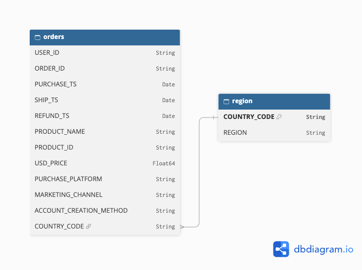

### `orders`
| Column | Type |
|---|---|
| `USER_ID` | String |
| `ORDER_ID` | String |
| `PURCHASE_TS` | Date |
| `SHIP_TS` | Date |
| `REFUND_TS` | Date |
| `PRODUCT_NAME` | String |
| `PRODUCT_ID` | String |
| `USD_PRICE` | Float64 |
| `PURCHASE_PLATFORM` | String |
| `MARKETING_CHANNEL` | String |
| `ACCOUNT_CREATION_METHOD` | String |
| `COUNTRY_CODE` | String (FK to `region`) |

### `region`
| Column | Type |
|---|---|
| `COUNTRY_CODE` | String (PK) |
| `REGION` | String |

---

## Insights Deep-Dive

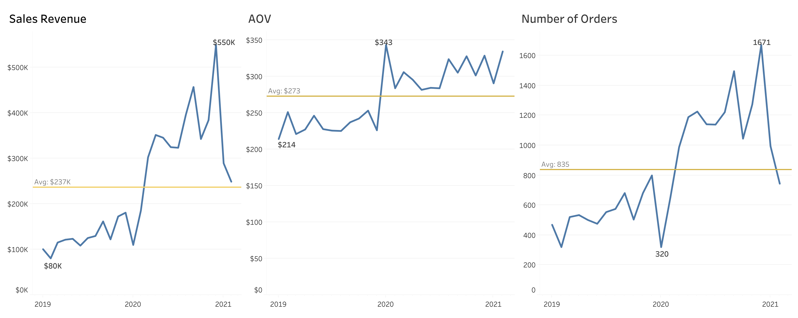

### Sales Revenue

**1. Rapid growth during the 2020 pandemic era**
- Revenue hovered near **$120K** through most of 2019 (Q1 to Q3).
- In 2020, sales reached **$185K in Feb (+68% MoM)** and exceeded **$300K from March onward (+63% MoM)**.
- 2019 generated ~$1.5M and 2020 generated $4M (**+166%**), suggesting strong pandemic-driven demand for gaming products.

**2. September to October 2020: fall pullback**
- Revenue reached **$456K in Sept 2020** but fell **25% to $343K in Oct**.
- A similar pattern occurred in 2019: **$161K in Sept to $122K in Oct (-24%)**.
- This points to a seasonal pattern, possibly back-to-school purchasing in September before normalizing in October.

**3. Sharp contraction in January after the December peak**
- Dec 2020 set a record at **$550K (+43% vs. Nov)**, then dropped **47% to $289K** in Jan 2021.
- Dec 2019 reached $180K, then fell **39% to $110K** in Jan 2020.
- Holiday shopping drives high demand followed by post-holiday normalization, so Q4 inventory should be planned accordingly.

### Average Order Value

**1. Sharp AOV surge in 2020**
- AOV rose from **$233 (2019) to $305 (2020)**, about a **31% increase**. It stayed between $230 and $240 through 2019 and peaked at $343.
- Q4 2020 AOV was consistently above $300, driven by holiday sales and the pandemic boom.

**2. Higher AOV does not always mean higher revenue**
- Jan 2020 saw a 52% AOV increase, but revenue declined 39%.
- Oct 2020 saw a 7% AOV increase while revenue fell 25%.
- Higher spend per order was not enough to offset declines in order activity.

**3. AOV and sales both rose in Dec 2020**
- AOV increased 9% while revenue increased 43%, likely due to higher order and customer volume rather than the modest AOV gain.

### Number of Orders

**1. Order count doubled from 2019 to 2020**
- **6,615 orders in 2019** vs. **13,364 in 2020**.
- Monthly orders were mostly 500 to 600 in 2019 and exceeded 1,000 for Q2 to Q4 2020.

**2. Order count closely tracks revenue**
- Feb 2020: orders **+104%**, sales **+69%** (AOV -17%).
- Oct 2020: orders **-30%**, sales **-25%** (AOV +7%).
- Orders generally moved in the same direction as revenue, even when AOV moved the opposite way, so **revenue changes are primarily driven by order volume**.

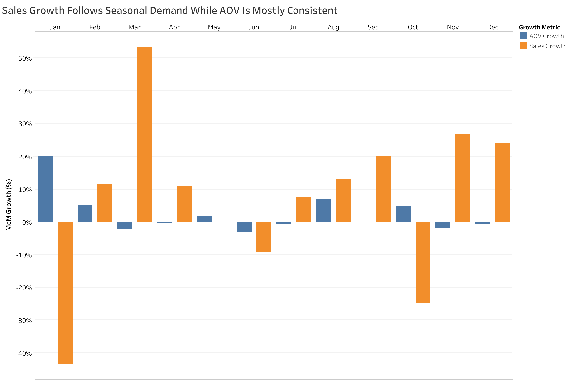

### Product Performance

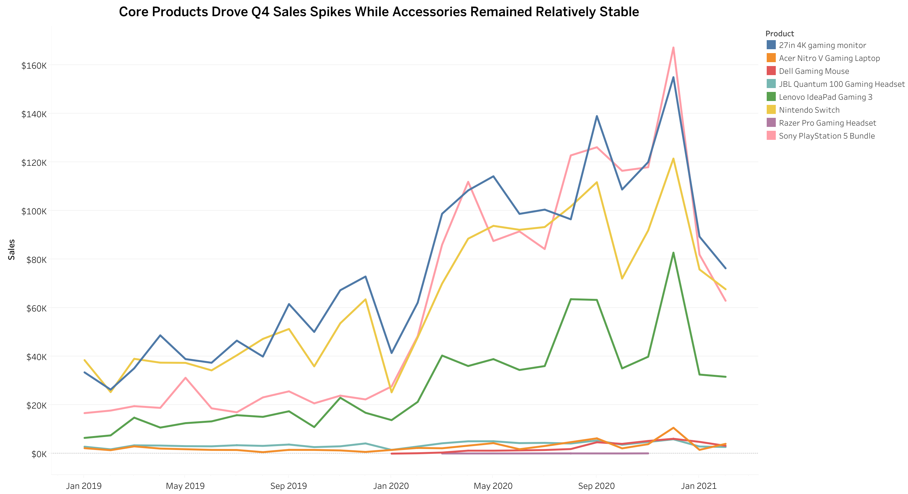

**Best and worst performers**
- The **27in 4K Gaming Monitor** is the top revenue product in both 2019 and 2020: **$1.97M (32% of total revenue)**.
- Next are the **Nintendo Switch ($1.66M)** and **Sony PlayStation 5 Bundle ($1.59M)**, followed by the **Lenovo IdeaPad Gaming 3 ($736K)**.
- The top four products account for nearly **97%** of total sales.
- The **Razer Pro Gaming Headset** is the weakest performer, with just 7 orders totaling $884.
- The **Dell Gaming Mouse ($36.5K)** and **Acer Nitro V Gaming Laptop ($65.7K)** contributed very little.

**Product mix**
| Product | Orders | Revenue per order |
|---|---|---|
| Nintendo Switch | 10,288 | ~$161 |
| 27in 4K Gaming Monitor | 4,686 | ~$420 |
| Sony PlayStation 5 Bundle | 967 | ~$1,643 |
| Lenovo IdeaPad Gaming 3 | 669 | ~$1,099 |
| JBL Quantum 100 Gaming Headset | n/a | ~$22 |
| Dell Gaming Mouse | n/a | ~$51 |

- The Switch is the most popular product by volume, but at a low price per order.
- The PS5 Bundle and IdeaPad are the strongest high-ticket products despite fewer orders.
- Low-priced accessories (JBL headset, Dell mouse) saw demand but contributed little revenue.

**Line chart findings**
- Consistent Q4 spikes in 2019 and 2020, likely from Black Friday, Cyber Monday, and Christmas sales.
- The 27in 4K Monitor and PS5 Bundle had the largest Q4 surges.
- Sales dip in January after the Q4 holiday peak.
- Accessories had low but stable sales in Q1 to Q3, while top products were more volatile.

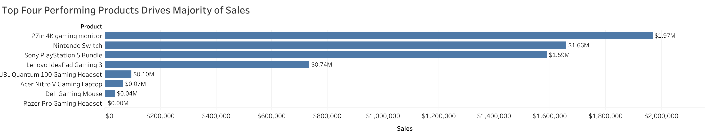

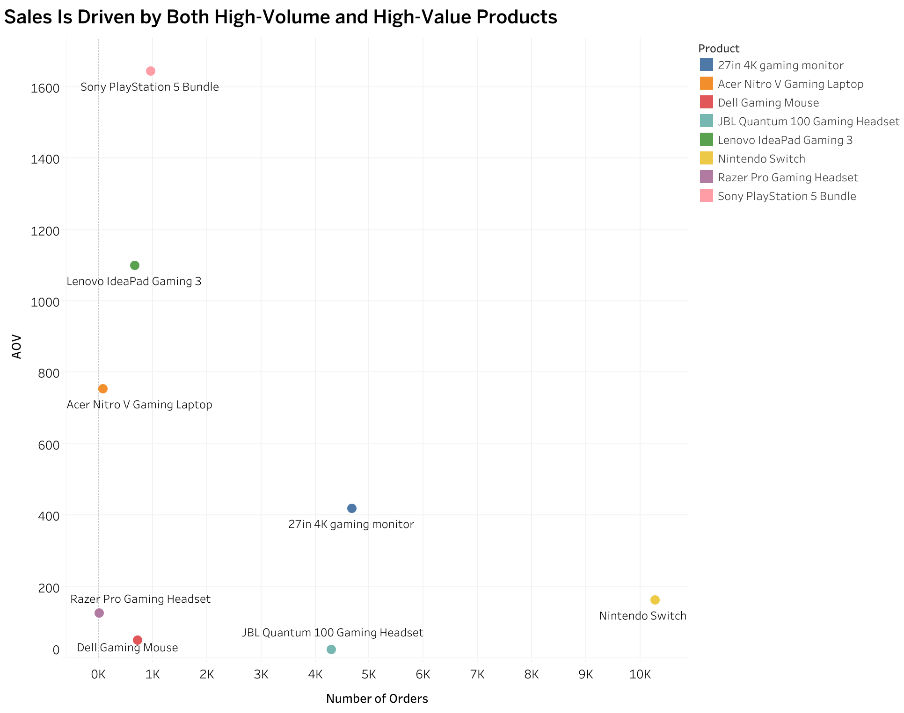

### Customer Purchasing Trends

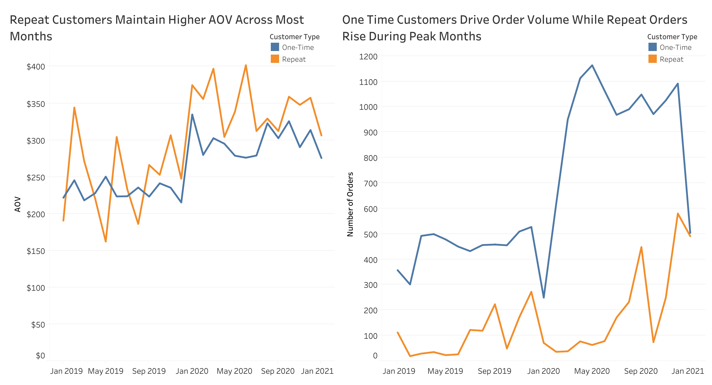

- **One-time buyers** grew orders from **5,414 (2019) to 11,247 (2020)** and revenue from **$1.2M to $3.4M**.
- **Repeat buyers** placed **1,021 orders in 2019 and 2,117 in 2020**, with **43% sales growth**.
- Repeat customers spent more per order in both years: **$230 vs. $298 in 2019** and **$248 vs. $340 in 2020** (one-time vs. repeat figures as reported in the source analysis).
- From Sept 2019 onward, repeat buyers held a higher AOV than one-time buyers but placed fewer orders. Repeat AOV grew **37%**, versus **30%** for one-time buyers.
- The pandemic boosted the customer base: one-time buyers rose from 5,414 to 11,247, and repeat customers from **629 to 1,095**.
- Gaps in order volume are driven mostly by the sheer number of one-time buyers.

### Refund Rates

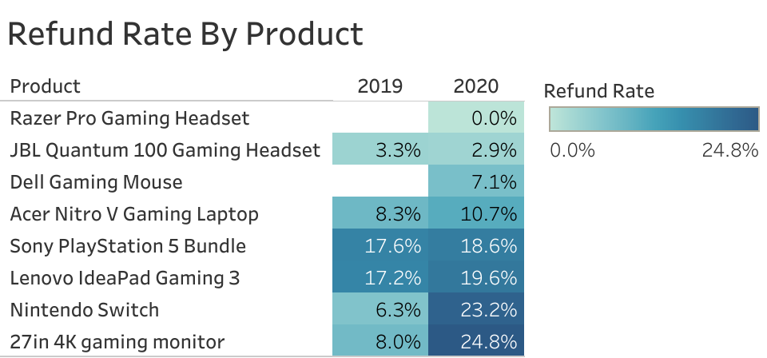

| Product | 2019 | 2020 |
|---|---|---|
| Razer Pro Gaming Headset | n/a | 0.0% |
| JBL Quantum 100 Gaming Headset | 3.3% | 2.9% |
| Dell Gaming Mouse | n/a | 7.1% |
| Acer Nitro V Gaming Laptop | 8.3% | 10.7% |
| Sony PlayStation 5 Bundle | 17.6% | 18.6% |
| Lenovo IdeaPad Gaming 3 | 17.2% | 19.6% |
| Nintendo Switch | 6.3% | 23.2% |
| 27in 4K Gaming Monitor | 8.0% | 24.8% |

- No orders were recorded for the Razer Pro Gaming Headset and Dell Gaming Mouse in 2019.
- Refund rates rose for every product except the JBL Quantum 100 Gaming Headset.
- The PS5 Bundle and IdeaPad were the most returned in 2019, and are also the most expensive items with the highest AOV.
- In 2020 the Nintendo Switch and 27in 4K Monitor had the highest refund rates, each rising by roughly 17 percentage points.
- The JBL headset kept the lowest refund rate despite being the third most ordered product.
- The top-selling products carry the highest refund rates.

### Regional Findings

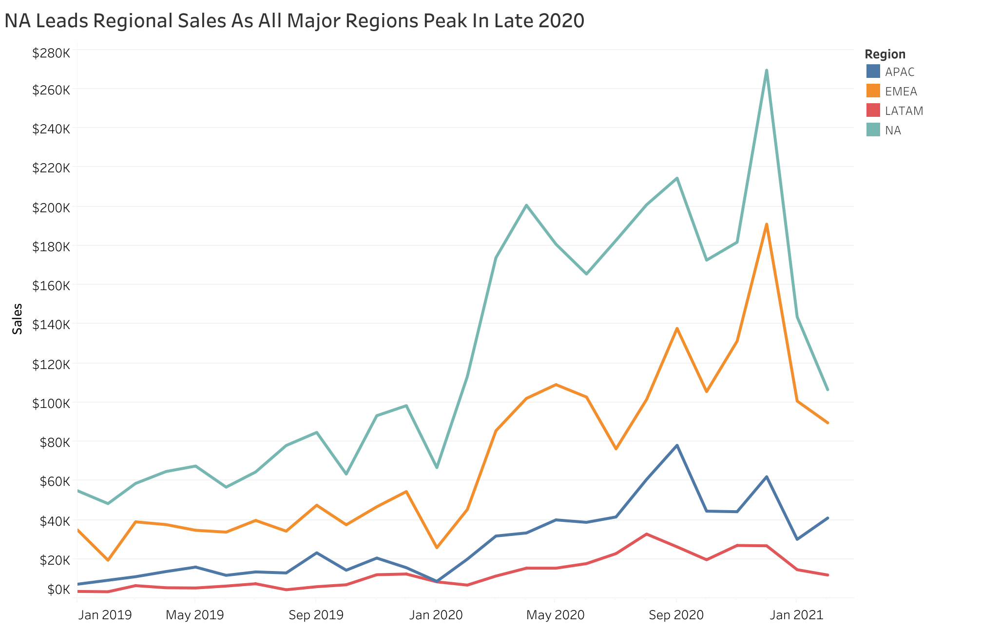

- **North America** is the largest market for every product, averaging **53% of sales per product** and accumulating **$3.2M** by early 2021.
- **Latin America** is the weakest, generating **$336K** in total, about **5%** per product.
- The **27in 4K Gaming Monitor** is the top item globally (~32% of regional sales on average), followed by the **PS5 Bundle (27%)** and **Nintendo Switch (26%)**.
- The **Nintendo Switch** is the most popular by order count, averaging **45% of orders** across regions.
- The **Razer Pro Gaming Headset** is the least popular, with almost 0% of revenue.

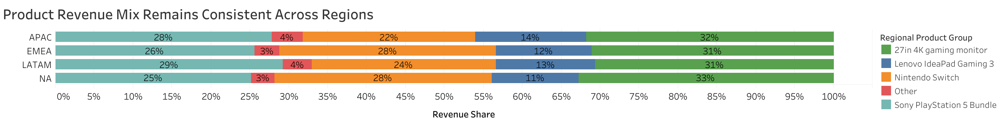

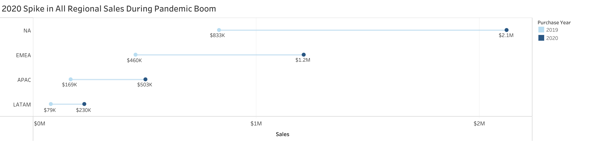

| Region | 2019 sales | 2020 sales |
|---|---|---|
| North America | $833K | $2.1M |
| EMEA | $460K | $1.2M |
| APAC | $169K | $503K |
| LATAM | $79K | $230K |

---

## Recommendations

### Sales
- **Boost marketing in the early-Q1 slump.** Sales fell 39% (Dec 2019 to Jan 2020) and 47% (Dec 2020 to Jan 2021).
- **Plan inventory and promotions around Q4 peaks.** Q4 sales climbed from $475K (2019) to $1.28M (2020), about +168%. Q4 orders rose from 1,984 to 3,990 (+101%) while AOV grew 34%.
- **Win back lost customers with return incentives** such as personalized bundles or early access to new drops. Orders fell 60% in Jan 2020 and 40% in Jan 2021, and customer volume dropped 57% and 46%.

### Products
- **Streamline inventory for best sellers.** The 27in 4K Monitor (~$2M), Nintendo Switch ($1.7M), and PS5 Bundle ($1.6M), plus the Lenovo IdeaPad, make up 97% of revenue.
- **Use lower-priced accessories for cross-sell and bundles.** The Dell Gaming Mouse and JBL headset have the lowest AOV but are still in demand.
- **Reassess the Razer Pro Gaming Headset** before allocating inventory, as it represents nearly 0% of sales and orders.

### Customer Retention
- **Run retention and win-back campaigns.** Repeat buyers consistently spend more per order from Sept 2019 onward, and one-time customers dominate the base, leaving room to convert them.
- **Test targeted incentives on high-value categories** rather than broad discounts. 35% of repeat-buyer orders are high-priced products vs. 28% for one-time buyers.

### Refund Rates
- **Prioritize root-cause investigations for expensive products.** The PS5 Bundle and IdeaPad average about 18% returns, and the Nintendo Switch and 27in 4K Monitor rose sharply in 2020.

### Regions
- **Protect North America**, Gamezone's strongest market (53% of product sales).
- **Expand in LATAM** with tailored product lines, additional marketing and purchasing platforms, and new product mixes (about 5% of product sales today).
- **Keep the top four products available in every region**, since they drive the majority of sales everywhere.

---

## Tools and Workflow

| Step | Tool |
|---|---|
| Source data and initial prep | Excel |
| Database and querying | PostgreSQL, DBeaver |
| Data model diagram | dbdiagram.io |
| Visualization and dashboards | Tableau |

**Workflow:** raw data was imported into PostgreSQL through DBeaver, cleaned into `orders_cleaned` and `region_cleaned` tables, then analyzed and visualized in Tableau.

---

## Repository Structure

```
.
├── README.md
└── images/
    ├── erd.png
    ├── kpi-trends.png
    ├── mom-growth.png
    ├── product-sales-trend.png
    ├── top-products-bar.png
    ├── volume-vs-value-scatter.png
    ├── customer-type-trends.png
    ├── refund-rate-heatmap.png
    ├── regional-sales-trend.png
    ├── regional-product-mix.png
    └── regional-2019-vs-2020.png
```
